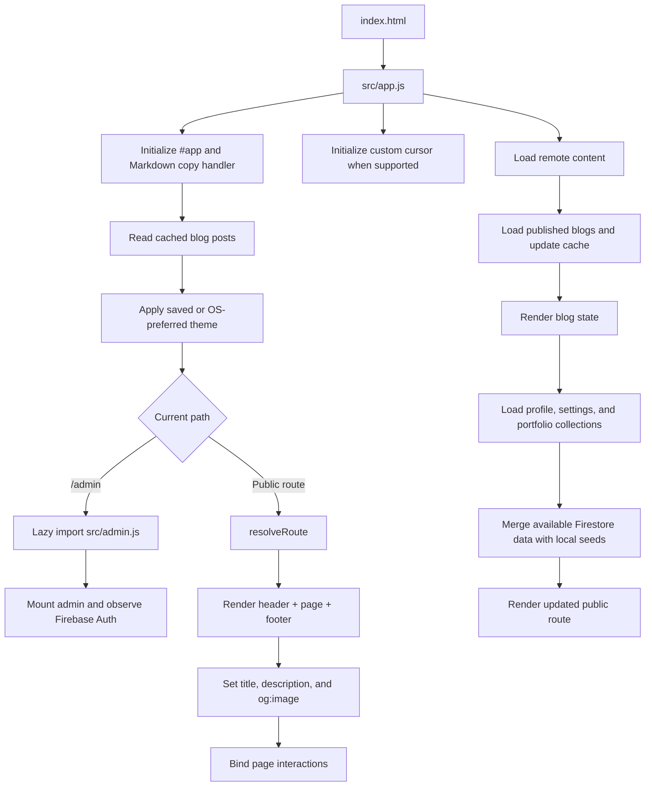
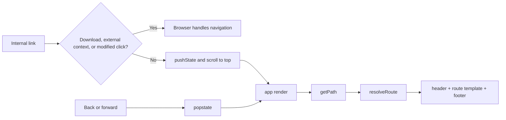

# FLOW.md — Application and development flow

This document follows the running application from browser startup through public rendering, user interactions, Firebase hydration, and the admin workflow. See [PROJECT.md](./PROJECT.md) for the source map and data contracts; see [AGENTS.md](./AGENTS.md) for change rules.

## Startup and public rendering

`index.html` provides the initial metadata, favicon, font preconnects, `#app` mount point, and a readable local-server message. It imports `/src/app.js` as a module. The app imports `styles.css`, loads the local seed object, and reads cached published blog posts before the first render.



Remote hydration begins after the initial local render. `loadRemoteBlogs()` runs first; it reads the published blog pipeline, updates the `portfolio-published-blogs-v2` localStorage cache, and returns cached/seed content plus an error state on failure. `loadRemotePortfolio()` then reads the portfolio collections and the `portfolio/public` and `settings/public` singleton documents. A successful remote response re-renders the current public route. Admin routes are skipped by the public loader.

## Routing and page composition

`getPath()` in `src/utils.js` normalizes the current pathname. `resolveRoute()` in `src/router.js` maps it to a page template and, for project/article detail routes, a route-specific document title. Unknown paths and unpublished/missing detail slugs use the 404 template.

Internal same-tab links are intercepted by `bindInternalNavigation()` in `src/interactions.js`: it updates history with `pushState`, scrolls to the top, and calls the app render function. File/download links, links opening another context, and modified clicks remain native browser navigation. The `popstate` listener re-renders on back/forward navigation. Firebase Hosting rewrites unknown paths to `/index.html`, allowing direct loads of routes such as `/projects/stealthshield`.



For public routes, `app.js` composes `header(data, route) + page.content + footer(data)`, updates the document title, description, and Open Graph image, then binds interactions. Page templates are plain functions returning HTML strings; they do not fetch data themselves.

## Page and interaction flow

- **Home (`/`)** — `homePage()` composes the hero, intro, up to three featured projects, skill groups, experience preview, milestones, recent writing, and contact callout. It reads `profile`, `projects`, `skillCategories`, `experience`, `achievements`, and `blogs` from the shared portfolio data object.
- **About (`/about`)** — `aboutPage()` renders the approach, portrait, focus/primary/interests, published skill groups, and education.
- **Experience (`/experience`)** — `experiencePage()` renders the published experience timeline and education rows.
- **Projects (`/projects`)** — `projectsPage()` builds project cards and filters from published projects. `bindProjectFilters()` applies category and text-search filters in the current DOM. `/projects/:slug` renders one project with its artwork, details, technologies, and available external actions.
- **Credentials (`/certificates`)** — `certificatesPage()` renders certificates and workshops/events, with an empty state if both collections are empty.
- **Blog (`/blog`)** — `blogPage()` displays published cards or the loading, error/retry, and empty states. `/blog/:slug` renders the article body with `renderMarkdown()`.
- **Contact (`/contact`)** — `contactPage()` renders social/contact links and a required name/email/message form. Submission builds a `mailto:` URL; there is no server-side form API.

`components.js` supplies the shared header, footer, project card, timeline, blog card, intro, and experience preview. `project-artwork.js` supplies category-based, theme-adaptive inline SVG thumbnails unless a project has a cover image. `styles.css` owns the shared theme tokens and responsive presentation.

## State and browser events

Public state is held in the mutable `portfolioData` object from `src/data.js`, plus the small `blogLoadState` object in `app.js`. Remote reads replace/merge sections and trigger a render; local seeds keep the site usable when data is missing or Firebase is unavailable. `published()` filters unpublished records and sorts by `order`.

`bindPageInteractions()` wires internal navigation, theme toggle, mobile menu, project filters, blog retry, contact form, and scroll reveal. Theme choice is stored in localStorage under `portfolio-theme`; absent a saved value, startup follows `prefers-color-scheme`. Scroll reveals use `IntersectionObserver` and become immediately visible if that API is unavailable. The custom cursor is initialized only for fine-pointer/hover devices when reduced motion is not requested.

`setupCodeCopy()` delegates code-copy clicks from the app root to the Clipboard API and reports success or failure in the button label. The blog preview is a tabbed editor: Markdown is rendered when the Preview tab is selected, not as a continuously updating live pane.

## Admin flow

`app.js` dynamically imports `src/admin.js` on `/admin`. The admin controller subscribes to Firebase Auth, renders checking/login/denied/unverified/workspace states, restricts the workspace to the configured verified owner, and refreshes the ID token before protected reads and writes. Profile and settings are singleton docs; other content sections load on demand. Blog and portfolio sections use their own store modules.

```mermaid
sequenceDiagram
  participant U as Owner
  participant A as admin.js
  participant AU as Firebase Auth
  participant S as Admin stores
  participant FS as Firestore / Storage
  U->>A: Open /admin and submit email/password
  A->>AU: onAuthStateChanged / signInWithEmailAndPassword
  AU-->>A: Auth user
  A->>A: Check owner email and emailVerified
  A->>AU: Refresh ID token and verify claims
  A->>S: Load selected content
  S->>FS: Read singleton docs / collection pipelines
  FS-->>S: Records
  S-->>A: Content plus section errors
  A-->>U: Render loading, feedback, list, or editor
  U->>A: Save, reorder, publish, or delete
  A->>S: Validate form and prepare record
  S->>FS: Upload asset if selected; write document/batch
  FS-->>A: Success or permission/network error
  A-->>U: Refresh section and show status
```

The admin supports email/password login, owner verification/resend, password reset, sign-out, section loading/retry, CRUD, publish toggles, ordering, and image/document uploads. Deletion uses a browser confirmation dialog. Content errors are converted to readable permission/offline messages; an `online` event retries the active section. Firebase rules—not the client-side gate—enforce owner access and field validation.

## Assets, integrations, and fallback behavior

- Static assets in `public/` are served from the site root. The résumé is referenced at `/assets/Manoj-Mourya-Resume.pdf`; portrait assets and `/favicon.svg` are used by the public templates and document shell.
- Firebase configuration is imported from `src/firebase-config.js`; no `.env` or `VITE_*` variables are read by this application. `src/firebase.js` uses Firestore pipelines for collection lists and Firestore Lite for fixed singleton reads.
- Hosted Google Fonts are preconnected from `index.html`. External portfolio actions are standard HTTPS links; contact submission hands off to the visitor’s mail app using `mailto:`.
- If Firebase config is missing or a collection read fails, the app keeps local seed content and logs a warning. Blog failures set an explicit error state with a reload action. Admin reads/writes show inline feedback and a retry action where applicable.
- Storage upload code and rules exist, but uploads depend on the Firebase Storage bucket being initialized and rules being deployed. Hosted HTTPS URLs and local `/assets/` paths are also supported by content fields.

For detailed source responsibilities, schemas, and deployment commands, continue to [PROJECT.md](./PROJECT.md).
